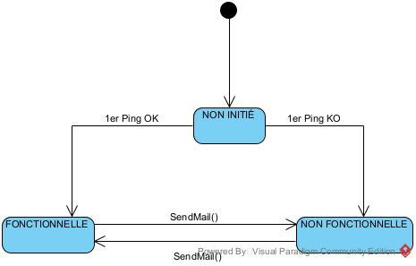
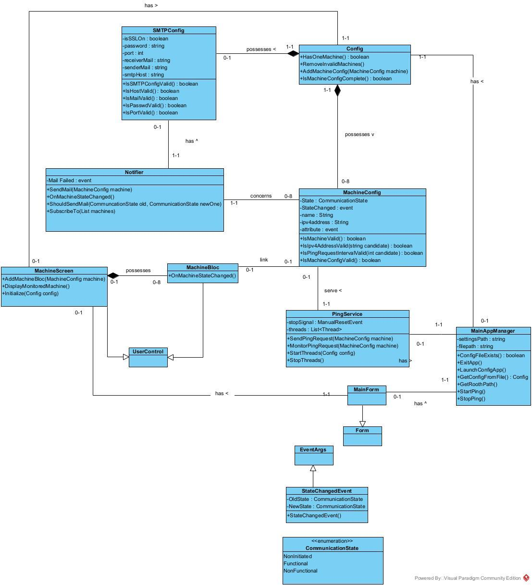
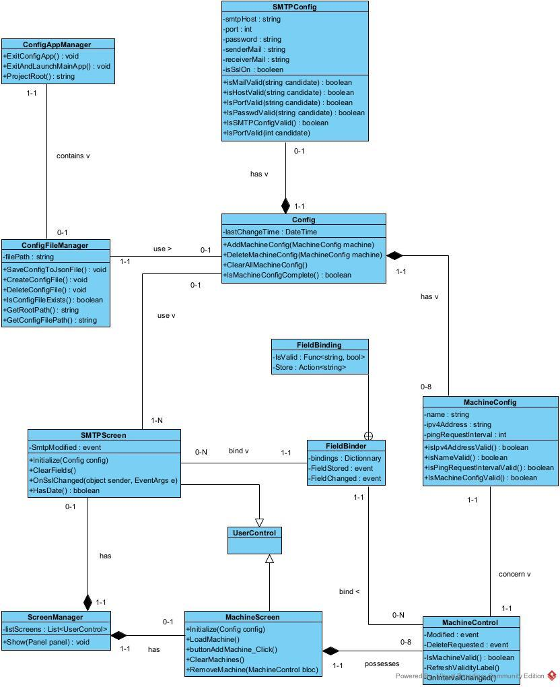

# Machine Monitoring

Solution Windows de surveillance de machines sur un réseau local, réalisée en C# dans le cadre du cours *Langages et développement 4* (Versioning et testing, Environnement de développement logiciel) à la Haute École Robert Schuman (HERS).

## Le problème

Quand une machine ou un service tombe en panne, l'équipe de maintenance doit être prévenue au plus vite. Les outils de supervision proposent en général deux volets : un affichage de l'état des machines surveillées, et une notification en cas de défaillance.

Cette solution reproduit ces deux volets à petite échelle : elle surveille jusqu'à **huit machines** d'un réseau local par **ping IPv4** et envoie un **e-mail** dès qu'une machine tombe ou redevient joignable.

## Contenu de la solution

La solution `machineMonitoring.slnx` regroupe trois projets :

| Projet | Rôle |
| ------ | ---- |
| `configApp` | Application de configuration (WinForms) |
| `mainApp` | Application principale de surveillance (WinForms) |
| `unitTest` | Tests unitaires (MSTest) |

### Application de configuration

* renseigner jusqu'à huit machines : nom, adresse IPv4 et intervalle de ping (chaque machine a son propre intervalle) ;
* renseigner les paramètres SMTP : hôte, port, SSL, expéditeur, destinataire et mot de passe ;
* sauvegarde **automatique** à chaque modification d'un champ, sans bouton « Enregistrer » ;
* affichage permanent de la date de la dernière modification ;
* remise à zéro de la configuration ;
* quitter à tout moment, ou quitter et lancer l'application principale quand la configuration est complète.

La configuration est enregistrée dans `settings/config.json`, à la racine de la solution.

### Application principale

* vérifie au démarrage qu'une configuration existe et contient au moins une machine ;
* interroge chaque machine par ping, à son propre rythme, sur son propre thread ;
* affiche l'état de la communication avec chaque machine ;
* envoie un e-mail lorsqu'une machine passe de fonctionnelle à non fonctionnelle, ou l'inverse.

## Analyse

Les diagrammes ont été réalisés avant le code, avec Visual Paradigm. Seules les classes présentes dans les diagrammes sont implémentées. Le dossier d'analyse complet se trouve dans [`docs/analyse.pdf`](docs/analyse.pdf).

### Diagramme d'états de la communication avec une machine

Une communication commence à l'état **non initiée**. Le premier ping la fait passer à **fonctionnelle** ou **non fonctionnelle**, sans envoyer de mail. Un e-mail n'est envoyé que lors d'un passage entre fonctionnelle et non fonctionnelle.

### Diagramme de classes de l'application principale

### Diagramme de classes de l'application de configuration

## Choix techniques

* **Un thread par machine** : chaque machine est interrogée selon son propre intervalle. Le service de ping intercepte toutes les erreurs pour qu'une machine injoignable n'arrête jamais la surveillance des autres.
* **Événements** : chaque machine publie un événement à chaque changement d'état. L'écran et le service de notification s'y abonnent, sans dépendre l'un de l'autre.
* **Validation stricte des adresses IPv4** : `IPAddress.TryParse` accepte des formes abrégées comme `127.1`. Une adresse n'est donc acceptée que si elle se relit exactement à l'identique après analyse.
* **Configuration en JSON** avec `System.Text.Json`, localisée à partir du dossier qui contient le fichier `.slnx`. La solution peut être déplacée sans casser l'accès à la configuration.

## Contraintes du projet

* Windows 10/11, sans droits administrateur et sans installation ;
* aucune dépendance externe : uniquement les classes natives de .NET et MSTest ;
* code et spécifications en anglais ;
* fichiers de moins de 200 lignes et méthodes de moins de 80 lignes ;
* un dépôt Git par projet, au moins un commit par classe, messages selon la convention Karma.

## Historique Git

Le projet a été développé dans trois dépôts Git séparés, comme l'exigeait l'énoncé. Pour la publication, ils ont été réunis dans ce dépôt avec `git subtree`, **en conservant leur historique complet** : les commits d'origine sont visibles dans `git log`.

## Installation

### Prérequis

* Windows 10 ou 11 ;
* Visual Studio 2026 avec la charge de travail « Développement .NET Desktop » ;
* le SDK .NET 10.

### Lancer l'application

1. Cloner le dépôt.
2. Ouvrir `machineMonitoring.slnx` dans Visual Studio.
3. Générer la solution (`Ctrl+Maj+B`) pour compiler les trois projets.
4. Lancer `configApp`, renseigner au moins une machine et les paramètres SMTP.
5. Quitter et lancer l'application principale depuis l'application de configuration.

Pour tester sans réseau, il est possible de surveiller l'adresse de bouclage `127.0.0.1`.

## Tests

Les tests se trouvent dans le projet `unitTest` et se lancent depuis l'Explorateur de tests de Visual Studio, ou avec `dotnet test`. Ils vérifient :

* le format des adresses IPv4 acceptées et refusées ;
* qu'un e-mail n'est envoyé que lors d'un passage entre fonctionnelle et non fonctionnelle ;
* que seules les machines valides sont conservées dans la configuration.

## Sécurité

Le fichier `settings/config.json` contient le mot de passe SMTP. Il est exclu du dépôt par le `.gitignore` et ne doit jamais être publié.

## Limites

Comme le précisait l'énoncé, un ping ne suffit pas toujours : une machine peut répondre au ping alors que son service est arrêté, et certaines machines bloquent volontairement les pings. Le projet est limité au réseau local, en IPv4.

## Projet

Projet individuel réalisé en Bloc 2 (2025-2026) à la **Haute École Robert Schuman (HERS)**.

Version publiée à des fins de portfolio.
